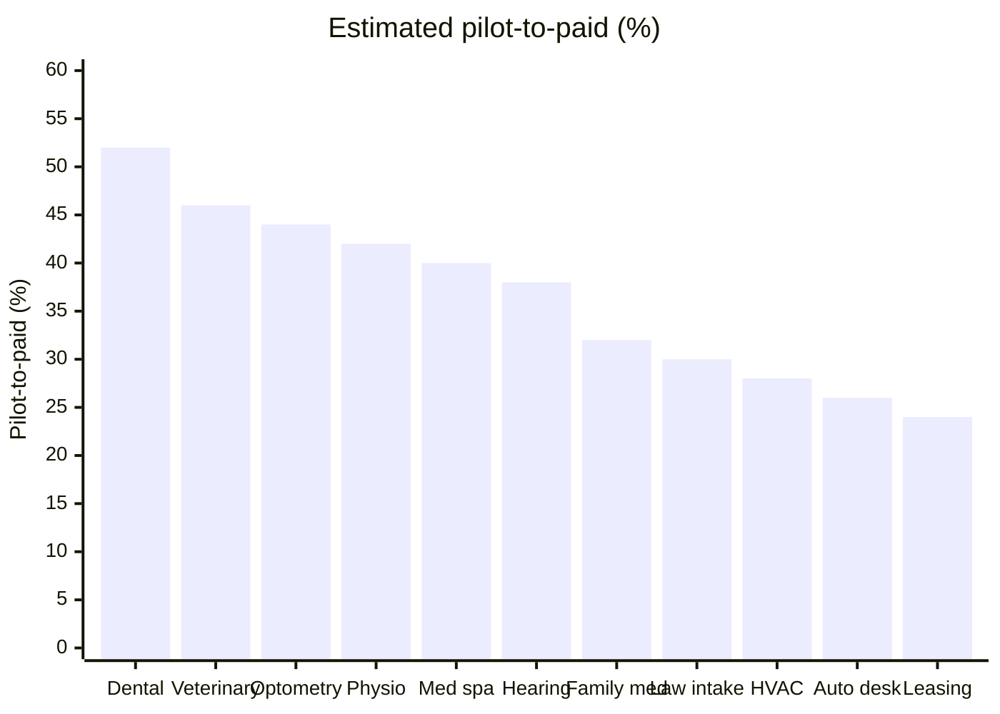

# Market fit

DentalFlow AI is a front desk for an independent dental clinic. It keeps calls, leads, and appointments in one place, follows up on the ones that stall, calls a missed inbound caller back by voice, answers from documents the clinic uploaded, and gives the owner a short report.

Use this note with [MARKETING.md](MARKETING.md). Describe only what the product does today. DentalFlow does not send text or email, does not sync a calendar, does not take payments, and does not give clinical advice or quote a fee that is not in an uploaded document.

## How to read the rates

**Pilot-to-paid** is the estimated share of owners who finish a 30-minute front-desk visit and a two-week callback pilot, then pay for a month.

**Booked-visit rate** is the estimated share of conversations that become that 30-minute visit.

DentalFlow has no paying-customer cohort. Every figure is a product-fit judgment from October 2026, not a measured result. Treat each number as the middle of a band about 8 points wide. The clinic writes the callback list. Voice minutes are billed separately from the software fee. A scheduled call goes out while the app is open, or while the n8n dispatcher is active.

## Dental clinics

Independent clinics with one front desk are the product as it stands. Pilot-to-paid is about **52%**.

The workflow already matches: a lead board, appointment follow-through, missed-caller recovery, a knowledge base, and a PDF the owner can read in a few minutes. A pilot ends when the owner will not let a voice call patients, or when the dispatcher is off and the callbacks never go out.

## Chance a conversation becomes a booked visit

Dental clinics only.

| Way in | Booked-visit rate | How to use it |
| --- | ---: | --- |
| Study club, or a dentist the seller already knows | 25% | Ask for the front-desk hour, not a software meeting |
| Local dental society, one 30-minute tour | 15% | Skip the booth speech |
| Office manager in the same plaza | 12% | One clinic that will take a reference call |
| Three-minute recording after a warm introduction | 10% | Fictional names only |
| Cold ads or a purchased list | 2% | Leave this channel alone |

## Chart: pilot-to-paid after adaptation

Percent of completed pilots that become a paid month. Dental clinics, with no adaptation, are the first bar at 52%. Source: product-fit estimate, October 2026, not a measured customer result.

Open the preview of this file to see the bars. The table under it uses the same numbers.

## Ten businesses after adaptation

Same shell: voice callback, a lead board, appointments, answers from uploaded documents, and a PDF. Change the script, the labels, and the documents. The voice books and follows up. It quotes a price only when that price is in an uploaded file.

Stay with dental clinics until one of them will take a reference call. Veterinary, optometry, physiotherapy, and med spas are the adaptations that sit near the dental baseline.

| Business | Pilot-to-paid | Change first | Main reason a pilot ends |
| --- | ---: | --- | --- |
| Veterinary clinics | 46% | Visit types and a transfer rule for emergencies | Owners still want a person on true emergencies |
| Optometry | 44% | Recall script and the fee sheet in the knowledge base | One recovered exam is worth less than an implant visit |
| Physiotherapy | 42% | No-show callback script and treatment names | Many already remind patients by text in Jane or Cliniko |
| Med spas | 40% | Consult script; prices only from uploaded menus | Staff reject a voice that quotes a treatment the menu does not list |
| Hearing clinics | 38% | Slower speech and a transfer to a person | Many patients will not stay on a call with an AI voice |
| Family medicine | 32% | Hours, booking, and refill routing only | Owners worry the voice will answer a clinical question |
| Law-firm intake | 30% | Conflict-check questions and a no-advice script | Partners will not leave intake on a tool with no matter file |
| HVAC and plumbing | 28% | Job-type list and a same-day callback script | Dispatchers already live in text and a calendar DentalFlow does not sync |
| Auto service desks | 26% | A daily status sheet the desk updates before callbacks | "Is my car ready?" is wrong the moment the sheet is stale |
| Property leasing desks | 24% | Showing script and a maintenance transfer rule | Leasing desks expect a calendar hold DentalFlow cannot write |

## Elevator pitch

Say this to a clinic owner or office manager. It is about 40 seconds.

> Ask any clinic owner how many of last month's inquiries actually turned into booked appointments, and most can't tell you. Not because they don't care — because nobody at the front desk has time to track every lead, chase every overdue recall patient, or follow up on the consult that never got scheduled. That's not a phone problem. That's revenue disappearing in plain sight.
>
> DentalFlow AI is the system that catches it. It gives the owner one place to see every call, lead, and appointment — and an AI front-desk teammate that follows through on all of it: calling back missed callers, re-engaging overdue patients, nudging leads that stalled before booking, and answering routine questions straight from the clinic's own policies, so it never guesses on a price or gives medical advice.
>
> The front desk doesn't get replaced — it gets backup that never drops the ball. And the owner finally sees, in real numbers, exactly where opportunity is being won or lost.
>
> Give me 30 minutes on your front-desk computer this week — with sample data, so no real patient is touched — and I'll show you exactly how many of your own inquiries are falling through the cracks right now.
